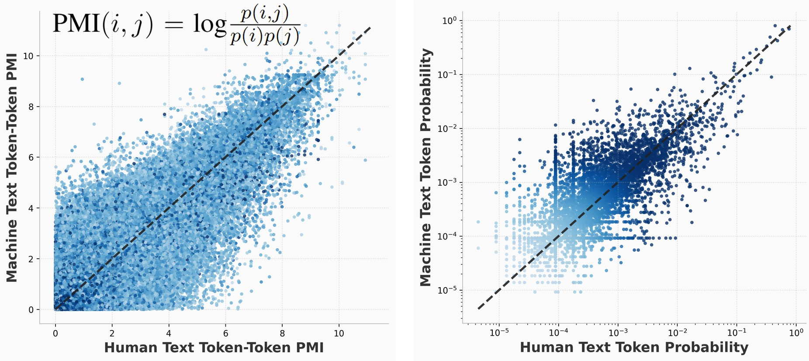
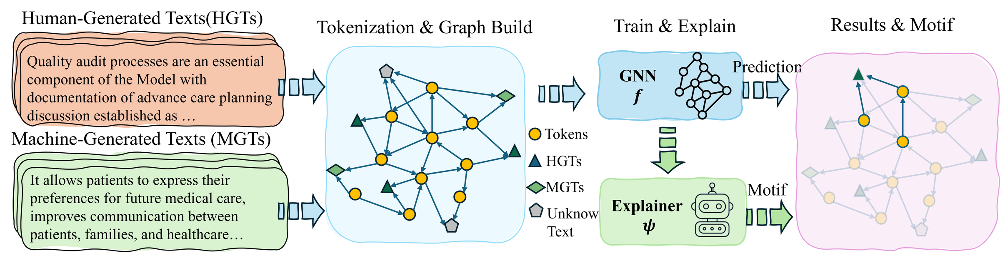

# LM²otifs

Code for **"Towards Structurally Graph-Based Explainable Machine-Generated Text Detection"**.

## Motivation

<p align="center"></p>

Token co-occurrence (PMI, left) separates machine-generated from human-written text far more
sharply than token probabilities (right). LM²otifs therefore makes word pairs first-class objects:
it detects machine-generated text on a corpus-level co-occurrence graph and explains its decisions
with **motifs**, the co-occurrence structures that separate the two classes.

## Pipeline

<p align="center"></p>

1. **Graph building.** Tokenize the corpus with the BERT tokenizer and build one graph. Token nodes
   are linked by positive PMI within a sliding window (default 20), and document nodes are linked
   to their tokens by TF-IDF. All statistics come from the training documents only. A test
   document joins the frozen graph through its own document–token edges.
2. **Detection.** A two-layer GCN classifies the document nodes as human or machine.
3. **Motif extraction.** A GNNExplainer mask selects the edges that drive the prediction.
   These edges form the motifs.

## Project structure

```
lm2otifs/            core package: data loaders, graph construction, models, training, explainers
scripts/             entry points (see below)
figures/             figures used in this README
```

## Usage

### 1. Prepare data

Place the datasets under `data/` (or point `--data_root` elsewhere):

```
data/hc3/{domain}_{train,valid,test}.csv          # python scripts/preprocess_hc3.py --raw all.jsonl --out data/hc3
data/m4/{domain}_{model}_{train,valid,test}.csv   # columns human_text, machine_text
data/raid/{domain}_{human|model}_{split}.csv      # column generation
data/{LLM}/{Yelp,Essay,Creative}_{human|model}.json
data/pubmed/pubmed_{model}.json                   # {"original": [...], "sampled": [...]}
```

### 2. Train and evaluate the detector

```bash
# HC3, four domains
python scripts/run_detection.py --bench hc3 --domains open_qa wiki_csai medicine finance

# M4 / RAID / Yelp-Essay-Creative with a given generator
python scripts/run_detection.py --bench m4   --domains reddit arxiv --models davinci
python scripts/run_detection.py --bench raid --domains books poetry --models gpt4
python scripts/run_detection.py --bench yec  --domains Yelp Essay   --models gemini

# cross-domain: train on open_qa, test on the other domains
python scripts/run_detection.py --bench hc3 --cross_src open_qa --domains wiki_csai medicine finance
```

Each test document is classified on its own (strict per-document evaluation). The script reports
accuracy and AUROC. Graphs, checkpoints and results are cached under `--work_dir` (default
`runs/`), and the other scripts reuse the trained detector.

Useful options: `--seeds 0 1 2 3 4`, `--weighted` (use PMI/TF-IDF values as edge weights),
`--unordered` (order-free co-occurrence counting), `--window 20`, `--tokenizer gpt2`,
`--node_init {identity,onehot,bert}`, `--device cuda:0`.

### 3. Extract and evaluate motifs

```bash
# corpus-level motifs (top word pairs / tokens per class) with HGT vs. MGT statistics
python scripts/run_global_motifs.py --bench hc3 --domains open_qa

# faithfulness of motifs vs. random edges (MoRF / LeRF); several --edge_size values = lambda sweep
python scripts/run_motif_faithfulness.py --bench hc3 --domains open_qa --n_docs 60
```

Motifs are written to `runs/global_motifs_<bench>/<domain>/class{0,1}_{edges,nodes}.csv`.

### 4. Further analyses

| Script | Purpose |
|---|---|
| `scripts/run_arch_sweep.py` | GCN / GAT / SAGE / Transformer / PNA on the same graph (`--weighted` for edge values) |
| `scripts/run_ww_ablation.py` | full graph vs. graph without word–word edges |
| `scripts/run_unified_attribution.py` | LIME, KernelSHAP, gradient and random token rankings on the same detector |
| `scripts/run_canary.py` | planted-evidence test (`--mode cooc` or `--mode bag`) |

All scripts share `--bench`, `--domains`, `--models`, `--data_root`, `--work_dir`, `--seeds` and
`--device`. Run any script with `-h` for the full list of options.
